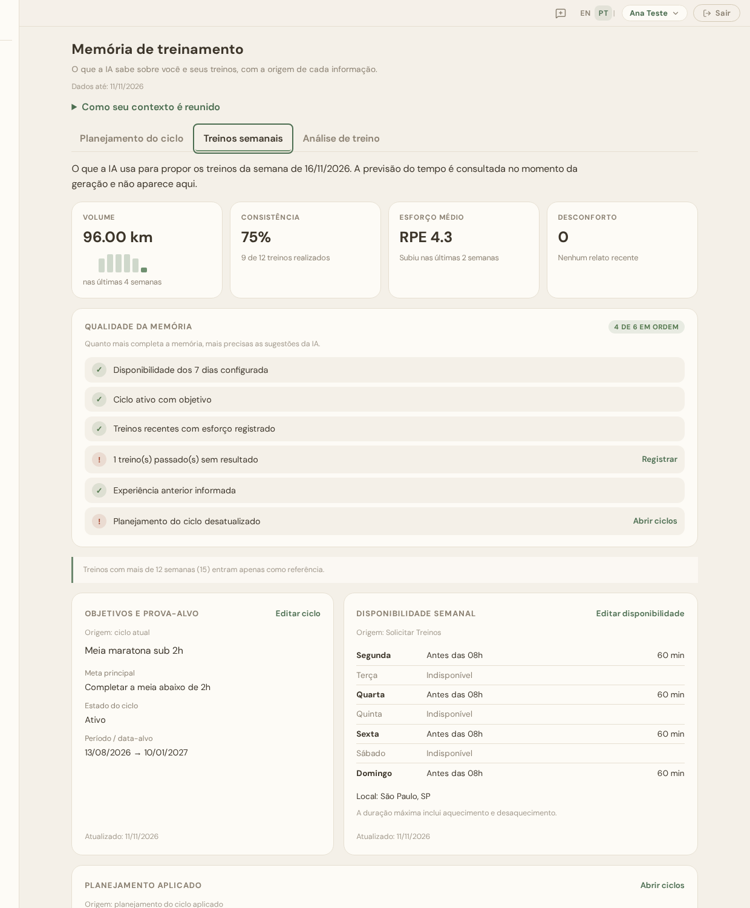
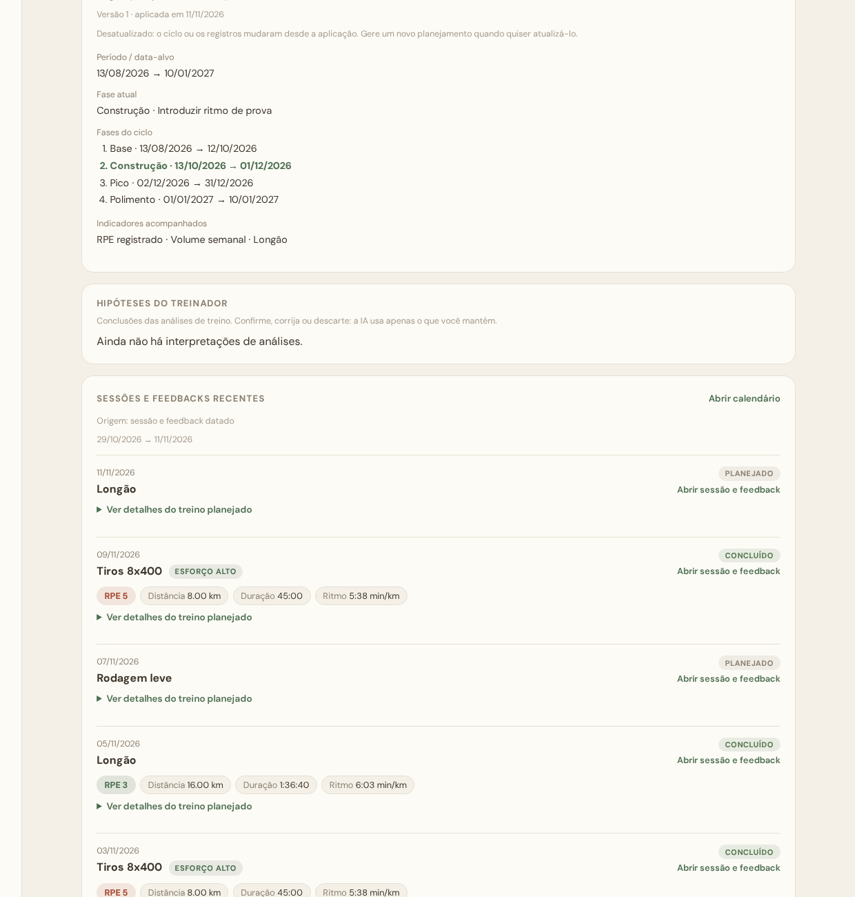
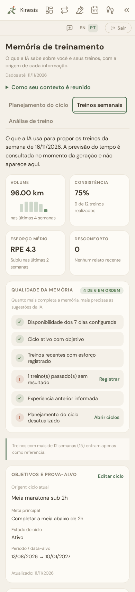

# Training memory review (issues #90–#93)

Training memory is the page that shows what the AI knows about the athlete. It
is also a readable projection of the exact context every AI task sends to the
model. This document records the four-phase review: what was wrong, what changed
and how it was verified. The contracts live in
[`docs/ai-foundation.md`](ai-foundation.md); this is the delivery record.

| Phase | Issue | PR | Scope |
| --- | --- | --- | --- |
| 1 | #90 | #94 | Context the AI receives: token budget, compact model projection, mandatory availability, chronological sessions, account time zone (`training-context-v6`) |
| 2 | #91 | #95 | Per-task views (cycle planning, weekly workouts, workout analysis), applied plan, shoes, previous cycles, priority badges, quantified omissions |
| 3 | #92 | #96 | Redesign: summary, memory-quality checklist, lists instead of tables, session cards, coach hypotheses, prior-experience cues |
| 4 | #93 | this PR | Layout tests, evaluation record, documentation review |

## What was wrong

With a realistic synthetic history, the page and the AI contexts lost most of
the athlete's data. The account had 16 weeks of completed sessions, seven
configured days, a shoe, an active cycle with an applied plan, and five
sessions planned for the next ten days.

| Block (cycle planning) | v5 (before) | v6 (after #94) |
| --- | --- | --- |
| Recent sessions | 7, in priority order | 7, newest first |
| Availability | 4 days, in English alphabetical order ("some days not configured") | 7 days, Monday to Sunday |
| Upcoming sessions | 0 | 5 |
| Weekly totals | 0 | 11 |
| Comparable sessions | 0 | 3 |
| Shoes | 0 | 1 |

The cause was the budget: `AI_CONTEXT_TOKENS` (12000) was compared with UTF-8
**bytes**, about 3,000 real tokens, and each session carried null fields and
64-character source versions. A second issue was "today": it was the server's
UTC date, which in Brazil is already the next day after 21:00.

## Evaluation on the synthetic account (after phases 1–3)

The account and data are synthetic, built in an in-memory database; no real
athlete data or paid model call was used. The figures below are the estimated
model tokens of each task's context, at the default 12,000 budget.

| Task | Estimated tokens | Recent | Upcoming | Weekly | Comparables | Availability | Shoes | Applied plan | Omitted |
| --- | --- | --- | --- | --- | --- | --- | --- | --- | --- |
| Cycle planning | 4,960 | 7 | 5 | 11 | 3 | 7 | 1 | — (never read) | 15 sessions older than 12 weeks (by design) |
| Weekly workouts | 5,206 | 7 | 5 | 11 | 3 | 7 | 1 | yes | same, plus 3 plan phases outside the task window (by design) |
| Workout analysis | 5,361 | 6 + the analyzed session | 5 | 11 | 3 | 7 | 1 | yes | same as weekly |

No block is cut by the budget. The only omissions are the configured history
window and plan phases outside the task's window, and both are reported. The
page shows the same numbers in each tab.

### Screens

Weekly workouts tab, desktop: summary, quality checklist, goals and availability.

Applied plan with the current phase, coach hypotheses and session cards.

Phone (390 px): tiles in a 2×2 grid, the checklist and lists without horizontal scroll.

## Verification

| Area | Tests |
| --- | --- |
| Selection (v6): budget in estimated tokens, compact model projection, mandatory and ordered availability, chronological recent sessions, upcoming fallback and omission, 413 refusals | `test/aiContextSelection.test.js`, `test/aiFoundation.test.js`, `test/cyclePlanning.test.js`, `test/weeklyWorkouts.test.js` |
| Account time zone: validation, local date, route, shell sync in Chrome, local cutoff for applying plans and dating experience | `test/timeZone.test.js`, `test/cyclePlanning.test.js` |
| Per-task projection: each tab equals its task's selection; plan, shoes, previous cycles, priorities, interpretation inclusion, omission counts, route validation and ownership | `test/aiMemoryPurposes.test.js`, `test/aiMemoryOverview.test.js` |
| Insights: weekly series, effort weighted by RPE reports, concerns within the period, partial flag, quality checklist | `test/memoryInsights.test.js` |
| Chrome: tabs by keyboard, stale and failed tab loads, write lock, analyzed session card, summary and checklist, experience cues, PT/EN | `test/trainingMemoryPurpose.browser.test.js`, `test/aiFoundation.browser.test.js` |
| Chrome layout: PT/EN × desktop, phone and short screens; no horizontal scroll; equal top cards with aligned "Updated" lines; visible keyboard focus on tabs and checklist actions; reduced motion | `test/trainingMemoryLayout.browser.test.js` |

Every PR passed the full gate (`npm run test:coverage`, 100% in all four
metrics) before each commit, and every Codex finding was fixed with a regression
test, or, once, answered with the owner's justification.

## Known limits

- The summary and the checklist only read the projection the page received;
  they are presentation, not another selection. When recent sessions or weekly
  totals are left out by the budget, the summary says it may be incomplete.
- Weather evidence is looked up when a weekly proposal is generated; the
  weekly-workouts tab states this instead of showing it.
- The browser stores the account's time zone; an account that never opened the
  app after #94 keeps UTC until it does.
